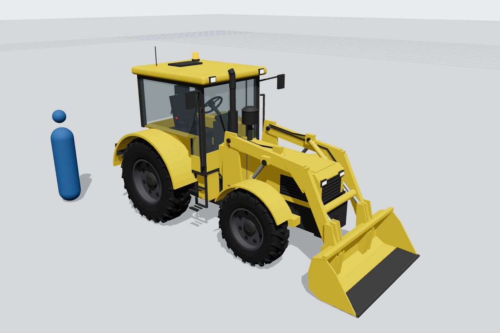
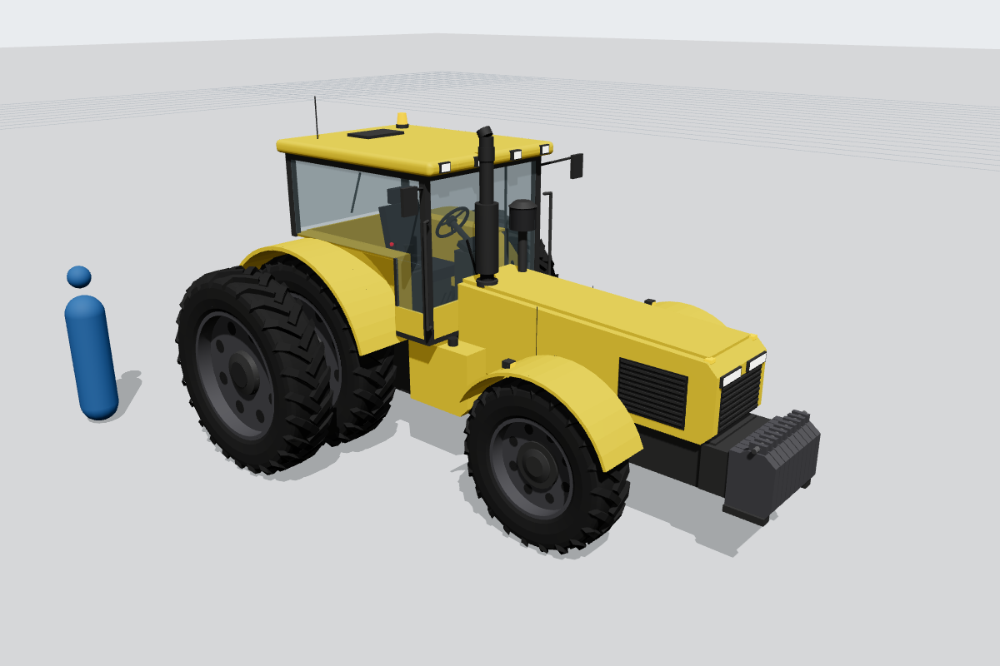
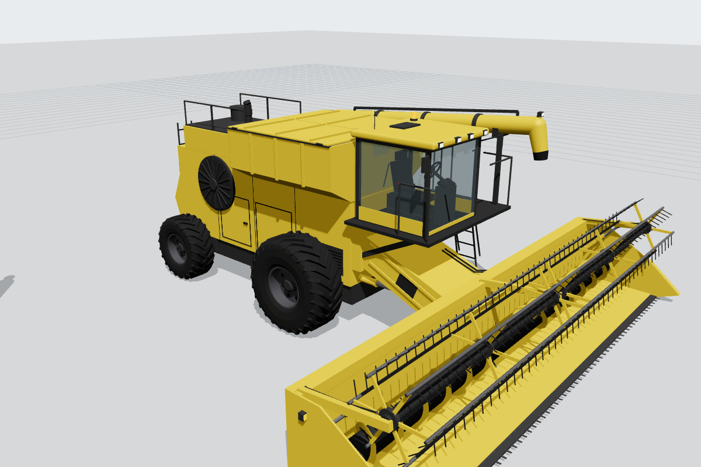
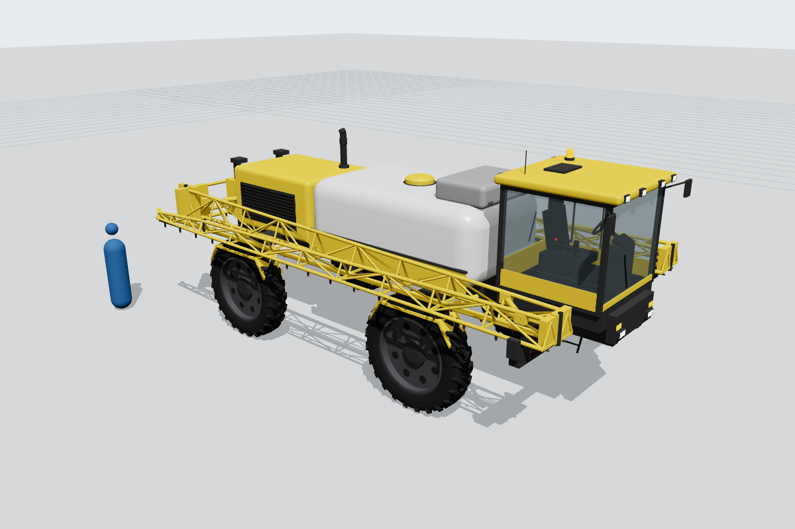
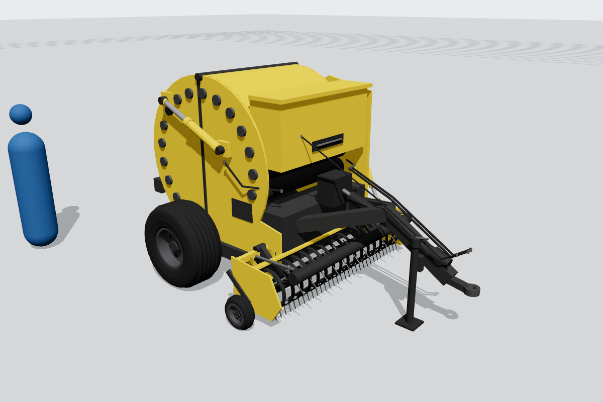
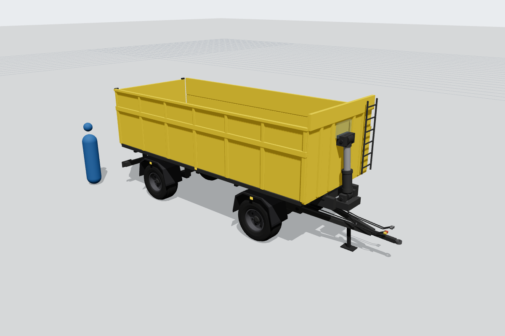
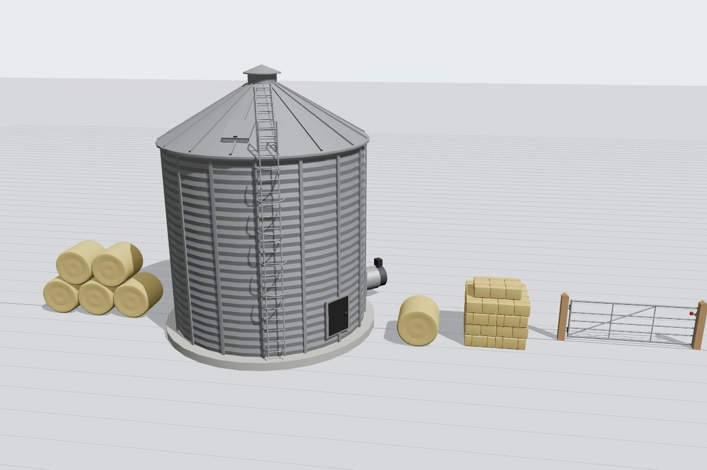

# Farm machinery pack

Seven true-scale (1:1, metres) farm models, each a single self-contained `.glb`, generated
from plain Python with the same toolkit as the Construction pack. Every rule in
[`../README.md`](../README.md) applies: +Y up, every machine faces +X, origin on the ground
centred under the model, rest pose with identity node rotations, descriptive node names, rig
suffixes with node origins on the real pivots, cylinders as `<name>_rotate` + `<name>_rod_slide`,
one material per surface type with a 1024² `baseColorTexture` named after it, white
`baseColorFactor`, UVs inside 0–1 with no overlaps and ≥ 4 px padding.

All machines share one unbranded house scheme: `paint_yellow` bodywork, `chassis_black` frames
and `paint_gray_dark` wheels and rims, as in the Construction pack. No logos, lettering or model
numbers; generic designs at typical class dimensions.

## Models

| Model | File | Size (L × W × H) | Tris | Moving parts / notes |
|---|---|---|---|---|
| **Utility tractor** (~75 hp, 4WD, ROPS cab) with **front loader** | `utility-tractor/utility_tractor.glb` | 5.14 × 2.24 × 2.63 m (2.95 to the antenna); 4.1 m long without the loader | 33.7k | Front wheels `wheel_front_{left,right}_steer` → `_spin`, rear `_spin`; loader on its own subtree `front_loader` (mount towers, fixed) → `loader_arm_tilt` → `bucket_tilt`, with `loader_lift_cylinder_*` and `loader_bucket_cylinder_*` and hoses; rear three-point hitch: lower links `hitch_tilt`, `hitch_lift_arm_tilt` (rockshaft), lift rods `hitch_lift_rod_*_rotate`, `hitch_top_link_tilt`. 12.4R24 front / 16.9R30 rear R1 tyres, 2.20 m wheelbase, 1.90 m bucket |
| **Row-crop tractor** (~250 hp, MFWD, cab) | `row-crop-tractor/row_crop_tractor.glb` | 6.25 × 4.01 × 3.13 m (3.45 to the exhaust/antenna) | 41.1k | Steered front axle `wheel_front_*_steer` → `_spin` with turning fenders; 480/80R50 **duals**: inner and outer wheel plus bar axle under one `wheel_rear_{left,right}_spin`; Cat III hitch (`hitch_tilt`, `hitch_lift_arm_tilt`, lift rods, `hitch_top_link_tilt`) with external `hitch_assist_cylinder_*`; 10 suitcase front weights, PTO, drawbar, 4 hydraulic remotes. 3.05 m wheelbase |
| **Combine harvester** (class 7, wheels) with **9.1 m grain header** | `combine-harvester/combine_harvester.glb` | 10.47 × 9.34 (header) × 3.98 m (4.30 to the antenna); 3.6 m wide over the drive tyres | 42.5k | `header_tilt` on the feederhouse pivot (feederhouse + header) lifted by `feederhouse_lift_cylinder_*`; `reel_arm_tilt` with `reel_lift_cylinder_*` → `reel_spin` (6 tine bars); cross auger flighting, knife guards, crop dividers, skid shoes; `grain_tank` with grain fill and fold-up `grain_tank_lid_{left,right}_tilt`; `unload_auger_rotate` (swings about Y on the riser) stowed forward along the left side in a cradle; rear `wheel_rear_*_steer` → `_spin`; cab with platform, ladder and handrails, rotary screen, chopper and spreader |
| **Self-propelled sprayer** (high clearance, 36 m boom) | `self-propelled-sprayer/self_propelled_sprayer.glb` | 8.77 × 4.34 × 3.63 m (transport) — 36.0 m wide unfolded | 41.5k | Boom folded for transport: `boom_lift` carriage (vertical slide on two masts, `boom_lift_cylinder`) → centre section → `boom_{left,right}_rotate` inner wings (swing 90° about Y) → `boom_*_outer_rotate` (folded 180° back alongside) → `boom_*_tip_rotate` breakaways, with `boom_*_fold_cylinder` and `boom_*_outer_fold_cylinder`; triangular trusses, spray line and nozzles every 0.5 m. ~6000 L poly tank, rinse tank, inductor, hub-motor legs (`wheel_front_*_steer`), 380/90R46 tyres, 3.0 m track |
| **Round baler** (towed, fixed chamber) | `round-baler/round_baler.glb` | 4.19 × 2.68 × 2.24 m | 29.7k | `tailgate_tilt` (rear half of the 18-roller chamber) with `tailgate_cylinder_*`; `pickup_tilt` with tine bars, stripper bands, wind guard, stub augers, `pickup_gauge_wheel_*_spin` and `pickup_lift_cylinder`; wheels `_spin`; net-wrap housing, PTO driveline, drawbar, parking jack, bale ramp. 1.25 × 1.20 m bales |
| **Tipping grain trailer** (two-axle, ~14 t) | `grain-trailer/grain_trailer.glb` | 7.65 × 2.50 × 3.05 m | 22.4k | `body_tilt` on rear hinges with front `hoist_cylinder`; `tailgate_tilt` (top-hinged) with `grain_chute_slide` hatch; turntable front axle `front_axle_steer` carrying `drawbar_tilt` (A-frame, stand, brake/hydraulic lines); wheels `_spin`. 6.0 × 2.4 m body, 1.0 m sides + 0.5 m extensions |
| **Farm props** | `farm-props/farm_props.glb` | 20.9 × 6.9 × 8.1 m (layout) | 16.2k | Separate root nodes: `round_bale_stack` (3 + 2), `small_square_bale_stack` (4 interlocked layers of 0.90 × 0.46 × 0.36 bales with twine), `round_bale`, `grain_bin` (6 m dia, 6 m eave, corrugated, stiffeners, caged ladder, roof ladder, peak vent, door, aeration fan, eave manway `hatch_rotate` hinged on its upper edge about X), `field_gate` (3.6 m galvanised gate on timber posts, `gate_rotate` about Y on the hinge pins, latch) |

## Expansion pack: implements, farm vehicles and yard props

Implements are sized for the **row-crop tractor**. Its hitch in exported (centred) coordinates:
lower-link ball ends 1.04 m apart (z = ±0.52) at 0.62 m above the ground and x = −3.07, top-link
end 1.18 m above the ground (0.56 m mast height), drawbar pin 0.51 m above the ground at x = −2.67.
Mounted implements put their lower hitch pins and top-link pin on those points; trailed ones put
their hitch eye at 0.51 m.

| Model | File | Size (L × W × H) | Tris | Matching tractor / moving parts / notes |
|---|---|---|---|---|
| **Reversible mounted plough** (5 furrow, 16 in) | `reversible-plough/reversible_plough.glb` | 7.26 × 2.94 × 1.71 m | 14.1k | Row-crop tractor, Cat III 3-point (lower pins 1.04 m apart at 0.62 m, top-link pin at 1.18 m on the headstock front face). `headstock` (fixed, parking stand, warning boards, hydraulic couplers) → `beam_rotate` (turnover 180° about the x-axis shaft at 0.86 m) carrying 5 lower + 5 upper bodies (mouldboard, share, shin, landside, heel, frog, leg with shear-bolt clamp, skim coulter), `turnover_cylinder` with hoses, `depth_wheel_arm_tilt` → `depth_wheel_spin`, depth spindle, rear lamp board and side reflectors. Rest pose: working position on the shares and the parking stand, bottom bodies throwing right |
| **Disc harrow** (trailed tandem, 6.0 m, folding) | `disc-harrow/disc_harrow.glb` | 4.48 × 3.65 × 2.93 m (transport); 6.0 m working width | 37.2k | Row-crop tractor drawbar (hitch eye at 0.51 m). Transport rest pose: wings folded upright on `wing_{left,right}_tilt` (hinges at z = ±1.12 on top of the frame; +90° / −90° about x unfolds them) with `wing_*_fold_cylinder`; 4 angled gangs of 560 mm discs at 230 mm (notched front, plain rear) with spools, bearing hangers and scraper bars; `transport_axle_tilt` with `axle_lift_cylinder_*` and four 11L-15 `wheel_*_{inner,outer}_spin`; A-frame drawbar, parking jack, hoses with couplers, rear lamps, blank SMV, hazard boards, reflectors |
| **Seed drill** (trailed pneumatic disc drill, 6.0 m, folding) | `seed-drill/seed_drill.glb` | 5.98 × 3.50 × 3.29 m (transport); 6.0 m working width | 38.1k | Row-crop tractor drawbar (hitch eye at 0.51 m). Trailed rather than mounted so the 6 m machine folds to a road width. ~3500 L front hopper with `hopper_lid_tilt` (front hinge), fan, distributor head and a seed hose to every coulter; 36 coulter units in two staggered ranks (single angled disc opener, seed boot, press wheel, spring) plus a following harrow; centre bar 1.5 m and `wing_{left,right}_tilt` (2.25 m, folded up 90° for transport) with `wing_*_fold_cylinder`; `marker_{left,right}_tilt` on the wing tips stowed back along the wings (±165° about x deploys them) with `marker_*_cylinder`; 400/60-15.5 `wheel_*_spin` with mudguards, parking jack, platform and ladder, couplers, rear lamps, blank SMV, hazard boards, reflectors |
<!-- expansion rows -->

Heights are to the cab roof unless noted; antennas and exhausts add a little. Triangle budget:
under 60k per machine and 20k for the props file (`save_farm` asserts it on every build).









## Materials

Standard names from the pack list, plus three new ones used only where nothing on the list fits
(`validate_glb.py` flags these names; that is the only finding it reports for this pack):

| New material | Used on |
|---|---|
| `hay` | round and small square bales (props) |
| `steel_galvanized` | grain bin, its ladders and the field gate (props) |
| `grain` | grain fill inside the combine's grain tank |

Other notes: the sprayer's main tank is `paint_white` (poly tank) with a `paint_gray` rinse tank;
`paint_red` / `paint_orange` appear only on small functional parts (nozzle tips, coupling heads,
bale twine, gate latch handle). The props also use the site-prop materials `timber` (gate posts)
and `concrete` (bin pad).

## Rig notes

* Wheels: `_spin` about Z at the wheel centre; steered wheels sit under a `_steer` node whose
  origin is on the kingpin (or the turntable centre on the trailer).
* The sprayer boom is authored unfolded and posed into the transport fold, so each hinge is a real
  pivot: rotating `boom_left_rotate` by +90° and `boom_left_outer_rotate` by 180° about Y unfolds
  the left wing to a straight 36 m boom (mirror signs on the right).
* Rigid links that follow two parts (hitch lift rods) are `_rotate` nodes with the origin on the
  upper pin, like the backhoe bucket link.
* R1 tyre bars are directional: the chevron tips lead in forward rotation on both sides.

## Building

```bash
python3 3d-models/Farm/build_all.py
```

```bash
python3 3d-models/validate_glb.py Farm
```

```bash
python3 3d-models/Farm/check_zfighting_farm.py
```

* `farm_parts.py` — Farm-only helpers: R1 chevron tractor tyre (`r1_tyre`, `ag_wheel`), ribbed
  implement tyre, mirrored wheel placement, four-post tractor cab (`tractor_cab`), tractor hood,
  three-point hitch with lift rods and optional assist cylinders, auger flighting, ladders, steps,
  mirrors, lamps, hoses, the farm material list (`FARM_MATERIALS`) and `save_farm` (writes the
  `.glb` and checks the triangle budget). It puts `3d-models/` on `sys.path` and imports the shared
  helpers (`meshkit`, `uvkit`, `vehicle_parts`, `dozer_parts`, `bodykit`) without modifying them.
* `build_*.py` — one script per model; `build_all.py` runs them all.
* `check_zfighting_farm.py` — runs the shared `check_zfighting.py` check over the Farm builders
  (the shared script only lists the Construction models). All Farm models report 0.
* `render_preview.js` + `render_preview.html` — renders a `preview.png` in the style of the
  dozer previews with Playwright and a local copy of three.js 0.160 (see the header comment);
  `pose=` lets you try the rig before export.

No shared file in `3d-models/` was edited. Nothing had to be copied from them either: the only
behaviour the Farm pack needed beyond the shared helpers (directional tread when mirroring a wheel,
cabs with fender cut-outs, new materials, triangle-budget checks) lives in `farm_parts.py`.
