# Mining expansion

The support fleet for the ultra-class mining machines: a large mining dozer, a large wheel
loader, a water cart, a mining motor grader, a mine-spec light vehicle and a set of mine
site props. **Expansion 2** adds an underground fleet (loader, haul truck, development
jumbo), a surface service / lube truck, a tyre handler and a set of processing props. Like the Construction models, each one is a single self-contained, true-scale
(metres) `.glb`, generated from plain Python. All of them follow the pack conventions in
[`../README.md`](../README.md): +Y up, facing +X, origin on the ground and centred, rest
pose with identity node rotations, descriptive node names, rig suffixes with origins on real
pivots, `<name>_rotate` + `<name>_rod_slide` hydraulic cylinders, one 1024² PNG
`baseColorTexture` per material named after it, white `baseColorFactor`, UVs in 0–1 with no
overlaps and ≥ 4 px padding.

All designs are generic, built to typical class dimensions: no logos, lettering, fleet
numbers or model numbers. Mine-number panels on the light vehicle are left blank.

## Models

| Model | File | Size (L × W × H) | Moving parts / notes |
|---|---|---|---|
| **Large mining dozer** (~100 t class) | `large-mining-dozer/large_mining_dozer.glb` | 10.3 × 6.4 (blade) × 4.7 m; 3.5 m over tracks | U-blade 6.30 × 2.65 m on push arms: `push_frame_tilt` (lift, trunnions on the track frames), `blade_tilt` (side tilt) with dual `blade_tilt_cylinder_{left,right}` and `blade_lift_cylinder_{left,right}`. Single-shank ripper `ripper_tilt` with `ripper_lift_cylinder_*` and `ripper_pitch_cylinder_*`. 2.80 m gauge, 710 mm single-grouser shoes on a 317 mm pitch belt, 8 bottom rollers, 2 carriers, idler and segmented sprocket per side (all `_spin`); each track is a group of 43 shoe nodes sharing one mesh (see below). ROPS cab with white roof, fender walkways with guardrails and kickplates, rear access stair, fuel and hydraulic tanks, hazard stripes. 55.7k tris drawn (43.5k unique) |
| **Large wheel loader** (~13 m³ bucket) | `large-wheel-loader/large_wheel_loader.glb` | 16.7 × 5.1 × 6.65 m | Articulated: front frame is `hitch_rotate` (vertical hitch pins) with `steering_cylinder_{left,right}`; oscillating `rear_axle_rotate`. Z-bar linkage: `lift_arm_tilt` with `lift_cylinder_{left,right}`, `bell_crank_tilt` on the arm cross tube driven by `tilt_cylinder`, `tilt_link_rotate` to `bucket_tilt` (carried racked back ~0.4 m off the ground). 45/65R45-class tyres (2.68 m) on 5.20 m wheelbase, 5.0 m 9-tooth rock bucket, rear stair, side decks with guardrails, tanks between the wheels, counterweight with hazard stripes. 45.5k tris |
| **Water cart** (~90 kL) | `water-cart/water_cart.glb` | 13.1 × 7.6 (mirrors; 7.0 over deck) × 6.6 m | Rigid two-axle haul-truck chassis: `wheel_front_{left,right}_steer` with `steering_cylinder_*`, duals on `wheel_rear_*_spin`, oil-pneumatic struts. Stepped 8.0 × 5.6 m tank (~89 m³ gross) with stiffening bands, tank-top walkway with guardrails, manholes and vent; front and rear ladders, diagonal front stairway, bumper deck with ladders. Front water cannon on a turret: `cannon_rotate` (Y) → `cannon_tilt` with `cannon_tilt_cylinder`. Rear spray bar with 4 heads (valve, actuator, fan deflector), pump. 40.00R57-class tyres. 58.2k tris |
| **Mining motor grader** (24 ft / 7.3 m moldboard) | `mining-motor-grader/mining_motor_grader.glb` | 13.5 × 5.05 × 4.6 m (moldboard angled 50° for travel; 4.0 m over tyres) | Articulated `front_frame_rotate` (the frame articulation) with `articulation_cylinder_*`; oscillating `front_axle_rotate` with `wheel_front_*_steer`; rear tandems on walking beams `tandem_{left,right}_tilt`. Blade chain: `drawbar_tilt` (ball joint, `lift_cylinder_{left,right}`) → `circle_rotate` (toothed circle) → `moldboard_tilt` (pitch, `moldboard_tip_cylinder_*`) → `moldboard_slide` (side shift on chrome rails, `moldboard_side_shift_cylinder`). Front scarifier `scarifier_tilt` with 7 shanks and `scarifier_lift_cylinder`. 29.5R29-class tyres, rear decks with guardrails and ladders. 57.9k tris |
| **Mine-spec light vehicle** (crew-cab 4x4 ute) | `mine-light-vehicle/mine_light_vehicle.glb` | 5.4 (5.5 with tow ball) × 1.9 (2.3 with mirrors) × 2.1 m to the beacon (2.4 to the aerial; 5.3 with the flag) | White body, internal 6-point ROPS, alloy bull bar with spotlights, side steps, snorkel, roof LED light bar and amber beacon, UHF aerial, flat alloy tray with drop sides, headboard, tray toolbox and two underbody toolboxes, rear bar with hazard stripes, blank mine-number panels (doors, bull bar, tailgate). `wheel_front_*_steer`, wheels `_spin`; the ~4 m buggy-whip flag (pole, pennant, tip lamp) is its own node `buggy_whip_flag`. 29.1k tris |
| **Mine site props** | `mine-site-props/mine_site_props.glb` | 24.6 × 5.7 × 3.6 m (four props in a row along x) | Separate nodes: **`lighting_plant`** (towable, generator canopy, 4 LED floods; mast `mast_lift` → `mast_stage_2_lift` → `mast_stage_3_lift`, ~2.0 m travel each; `lamp_head_rotate`; `outrigger_{front,rear}_{left,right}_slide`; wheels and jockey wheel `_spin`), **`safety_berm_section`** (modular 6 m windrow, 2.0 m high, 5.7 m base, flat ends so sections butt together, embedded rocks), **`haul_road_sign`** (2.5 × 1.4 m blank face on two posts with concrete footings), **`fuel_bowser`** (self-bunded skid tank ~25 kL with pump cabinet, meter, `fuel_hose_reel_spin`, nozzle holster, ladder, top guardrail, vents, manhole, fork pockets). 8.3k tris |
| **Underground loader (LHD)** (~14 t payload class) | `underground-loader/underground_loader.glb` | 11.0 × 2.7 (2.9 with mirror) × 2.4 m (2.5 to the beacon) | Very low profile. Articulated: front frame is `hitch_rotate` with `steering_cylinder_{left,right}`; oscillating `rear_axle_rotate`. `boom_tilt` with `boom_lift_cylinder_{left,right}`, `bucket_tilt` driven by `bucket_tilt_cylinder` on the boom cross tube; 6 m³ 2.6 m bucket with bolt-on flat edge and heel wear strips. Side-mounted operator compartment (left of the rear frame) with ROPS/FOPS canopy, transverse seat, joystick consoles, glazing and outer mesh guard, step and grab handles. Rear engine with louvres, rear radiator grille, exhaust scrubber box on the hood, pre-cleaner, fire-suppression bottle. Lamps, amber indicators and hazard stripes at both ends (front fenders, rear bumper), beacon. 18.00R25-class tyres. 36.5k tris |
| **Underground haul truck** (~50 t payload) | `underground-haul-truck/underground_haul_truck.glb` | 10.7 × 3.0 (3.1 with mirror) × 2.8 m | Articulated: the rear unit is `hitch_rotate` (vertical hitch pins) with `steering_cylinder_{left,right}`. ~25 m³ tray 3.0 m wide on `dump_body_tilt` (hinge pins at the rear of the frame) with `hoist_cylinder_{left,right}`; wear-plate floor, tail chute, side stiffeners and top rails, front spill lip, under-floor rails. Low enclosed cab on the left beside the front engine bay (glazed door, transverse seat, joysticks, grab handles, lamps fore and aft, beacon, mirror). Engine bay with louvres, exhaust scrubber box, pre-cleaner, front radiator grille; fuel tank with sight gauge. Front bumper and rear frame end with lamps, indicators and hazard stripes; tray tail guards with stripes and reflectors. 18.00R33-class tyres. 33.4k tris |
| **Twin-boom development jumbo** (face drilling rig) | `development-jumbo/development_jumbo.glb` | 14.2 × 2.55 × 2.95 m (3.1 to the beacon) | Articulated: the rear unit is `hitch_rotate` with `steering_cylinder_{left,right}`. Two booms, each `boom_<side>_rotate` (swing about Y on a turntable, `boom_<side>_swing_cylinder`) → `boom_<side>_tilt` (lift, `boom_<side>_lift_cylinder`; telescopic tube with hose runs and a work lamp) → `feed_<side>_slide` (4.5 m aluminium feed along x, rails, front centraliser, drill rod) → `rock_drill_<side>_slide` (drill on its carriage, hoses). Front stabiliser jacks `stabiliser_{left,right}_lift` (retracted). Centre FOPS canopy (open sides with mesh guard, seat, joysticks, glazing, lamps, beacon), hydraulic tank and electrical cabinet beside it. Rear unit: power pack and electrical cabinet, diesel tramming engine with scrubber box, `cable_reel_spin` (~1.9 m reel in `cable_rubber`) with cable guide, rear bumper, light posts with hazard stripes; front nose with lamps and stripes. 12.00-24-class tyres. 41.8k tris |
| **Service / lube truck** (surface, rigid 6x4) | `service-truck/service_truck.glb` | 10.2 × 2.5 (3.0 with mirrors) × 3.5 m | Conventional bonneted day cab (white) with glazing, seats, steering wheel, steps, grab handles, mirrors, roof lamps, two beacons; `wheel_front_*_steer`, single fronts and tandem duals on `wheel_*_spin` (315/80R22.5-class). Service body: three bays of roll-up doors each side, `door_{left,right}_{1,2,3}_slide` (slide up into the head boxes); three fluid tanks in saddles across the front (colour bands for oil, hydraulic oil, coolant; fill caps, vents); open rear bay with four `hose_reel_{1..4}_spin`, hoses and nozzle holsters; headboard with lamps and beacon; rear deck with grating, guardrail and rear ladder; rear bumper with lamps and hazard stripes. Knuckle crane on the rear deck, stowed folded: `crane_rotate` (Y) → `crane_boom_tilt` (`crane_boom_cylinder`) → `crane_jib_tilt` (`crane_jib_cylinder`), hook, control station. Exhaust stack, air intake, fuel tank, battery box, mudflaps. 56.6k tris |
| **Tyre handler** (loader-based) | `tyre-handler/tyre_handler.glb` | 9.4 × 3.5 × 4.0 m (4.1 to the beacons) | Articulated wheel-loader carrier: front frame is `hitch_rotate` with `steering_cylinder_{left,right}`, oscillating `rear_axle_rotate`. Manipulator: `arm_tilt` (twin arms, `arm_lift_cylinder_{left,right}`) → `gripper_tilt` (pitch on the arm-tip pins, `gripper_tilt_cylinder`) → `gripper_rotate` (roll about X on a slew bearing, roll motor) → clamp pads `pad_left_slide` / `pad_right_slide` on a chrome-guided beam, each driven by `pad_<side>_cylinder`; pads with rubber facings, two turning rollers and a lamp. ROPS cab with white roof unit, beacons and lamps; side decks with guardrails, ladder, fuel and hydraulic tanks; engine enclosure with louvres, exhaust, pre-cleaner, rear radiator grille, counterweight with lamps and hazard stripes; front bumper stripes. 23.5R25-class tyres. 42.3k tris |
| **Mine processing props** | `mine-processing-props/mine_processing_props.glb` | 40.5 × 23.0 × 9.0 m (five props in two rows, ≥ 0.6 m apart) | Separate top-level nodes: **`mobile_jaw_crusher`** (~15 × 3.4 × 3.8 m tracked plant; static tracks with shoes, idlers, sprockets and rollers; flared feed hopper over a grizzly feeder, jaw chamber with flywheels, belt guard and motor, power unit with louvres and exhaust, control cabinet, walkway with guardrail and ladder, inclined product conveyor, lamp, beacon, hazard stripes at both ends), **`conveyor_section`** (20 m, ~7° incline, 900 mm belt troughed over 35° three-roll idler sets every 1.2 m, return belt and idlers, head and tail pulleys, drive and discharge hood, side walkway with handrail, four trestles on concrete pads), **`stockpile_cone`** (`gravel`, 9.2 m base, 3.2 m high), **`site_office`** (12 × 3 m crib room on skids: panelled walls, roof with gutter, framed windows, door with landing, steps and handrails, lamp, wall AC units, meter box), **`underground_portal`** (10 × 8 m concrete headwall with cope beam and wing walls, D-shaped 5.0 × 6.0 m opening, `dirt` backfill, concrete-lined tunnel stub with gravel floor, three steel sets with collar ties, portal lamps, yellow ventilation duct hung on a messenger wire running out and down to a surface fan with starter box). 18.7k tris |

### Dozer track structure

Each track is a group node, `track_right` / `track_left` (origin at the track centre line,
z = ±1.40), whose children are the individual shoes in order round the loop:
`track_right_shoe_00` … `track_right_shoe_42` (43 per side, same for left). Both sides are
numbered in the same direction: counter-clockwise seen from +Z, so shoe 00 sits at the
back of the sprocket and the sequence runs down round it and forward along the ground run. The shoes have no rig suffix.

* Each shoe node's origin sits on the chain pitch line (the belt path round the idler and
  sprocket pitch circles). Its rotation follows the loop: local +X along the tangent (the
  travel direction), local +Y inward toward the rollers, local +Z = +Z.
* Shoes are evenly spaced along the loop at 0.3135 m: the loop length divided by 43, the
  317 mm pitch rounded to a whole number of shoes. Moving shoe N to shoe N+1's rest
  transform (translation and rotation) runs the track forward one shoe; looping that makes
  it run continuously.
* All 86 shoes share one mesh, `track_shoe` (144 triangles), through glTF mesh reuse. The
  file holds 43.5k unique triangles and draws 55.7k.
* Rollers, carrier rollers, idlers and sprockets remain `_spin` nodes with their origins
  on their centres.

The per-shoe nodes are written by `track_loop_nodes` and `save_with_instanced_tracks` in
`mining_parts.py`. After the shared writer runs, they rewrite the `.glb` so every shoe
node points at the first shoe's mesh, moved into the shoe's local frame.

**Validator note:** `validate_glb.py` requires rest-pose nodes to carry translation only,
so it reports `node "track_*_shoe_NN" has rotation` for each of the 86 shoe nodes. This is
inherent to rotated, mesh-sharing shoes. Every other check passes for the dozer: bounds,
ground contact, UVs, materials and names.

Every machine is under the 80k-triangle budget and the props file is under 20k. The
expansion 2 machines are each under 60k triangles and the processing props file is under 25k. Heights are
to the top of the cab roof unit or beacons; aerials and exhaust tips add a little.

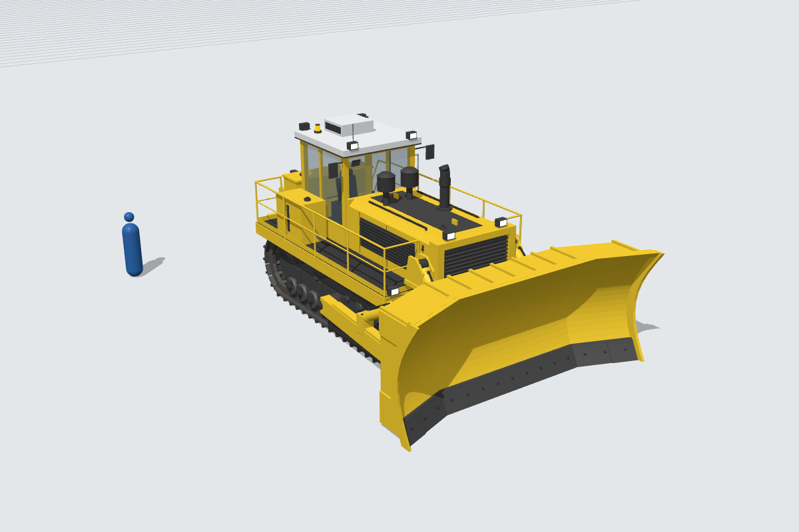
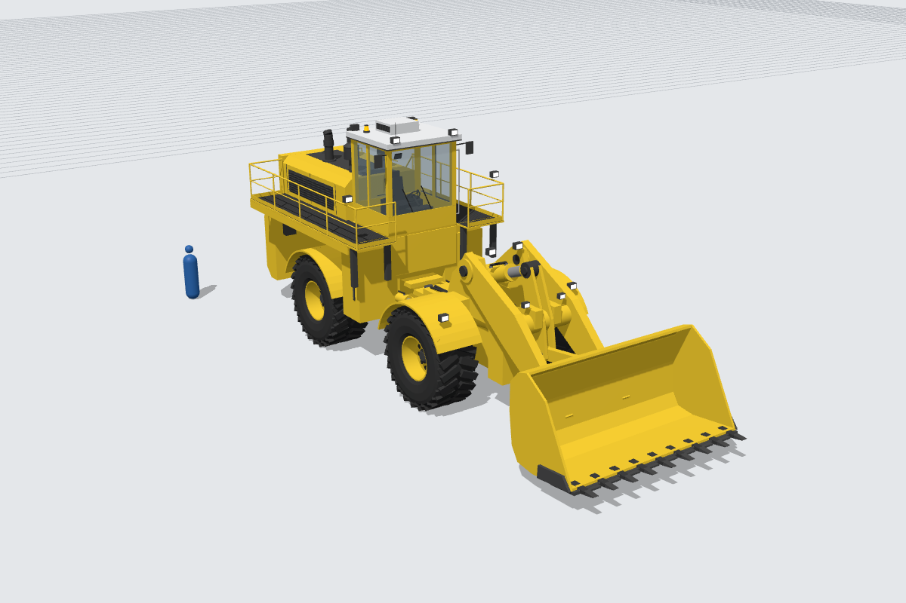
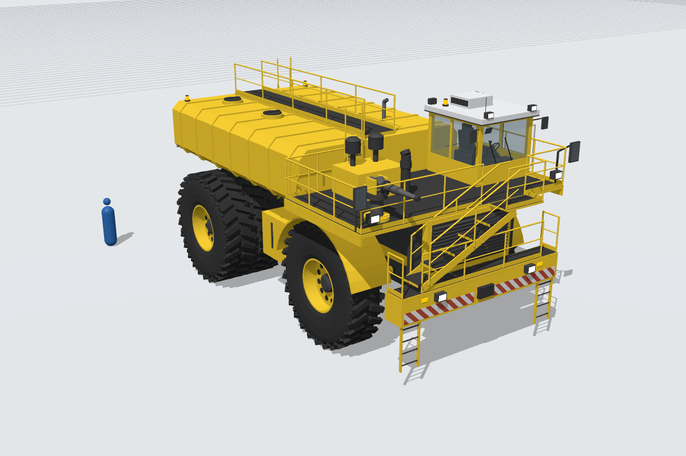
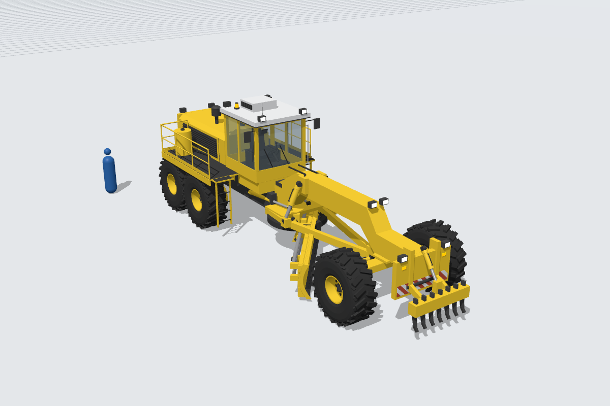
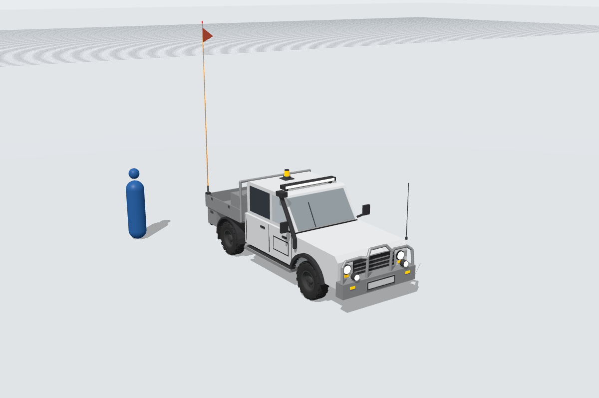
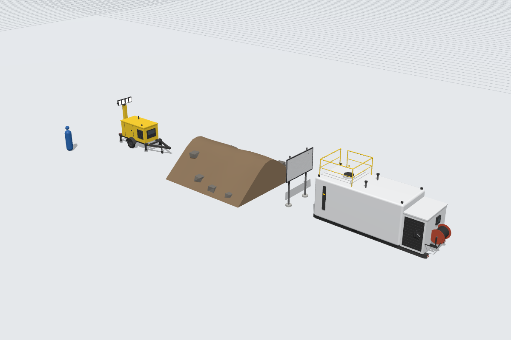
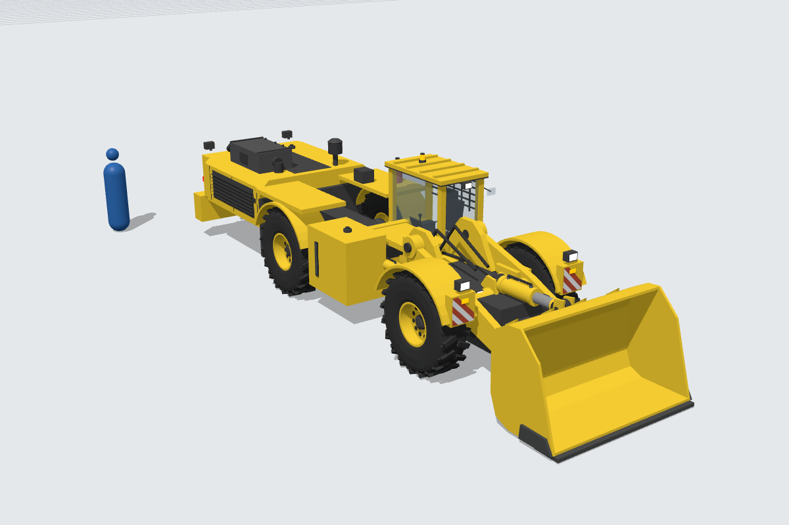
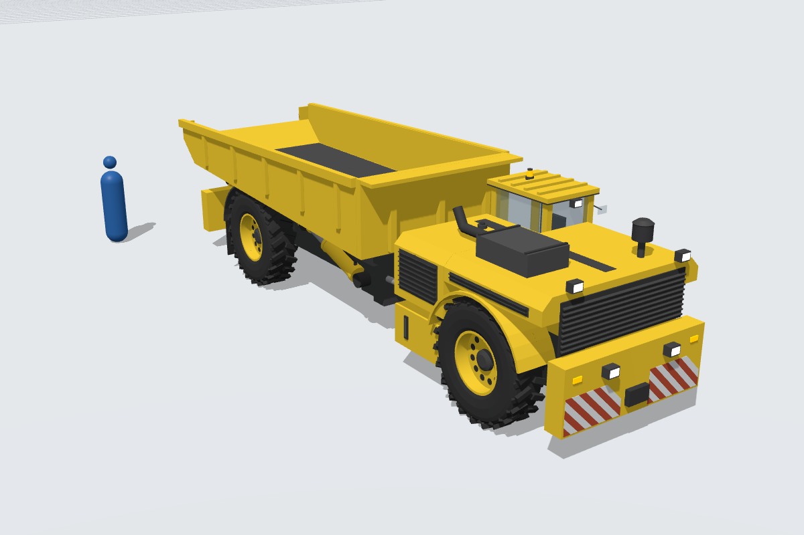
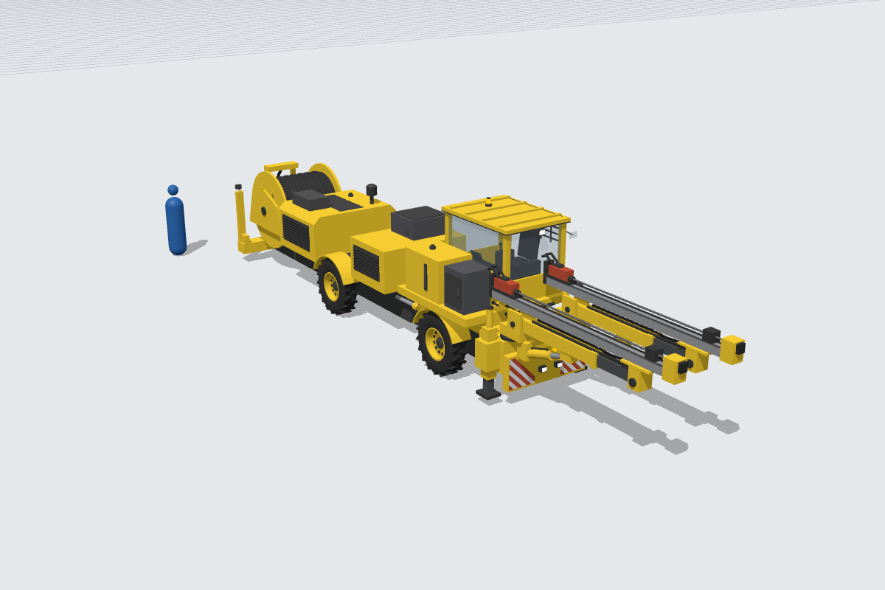
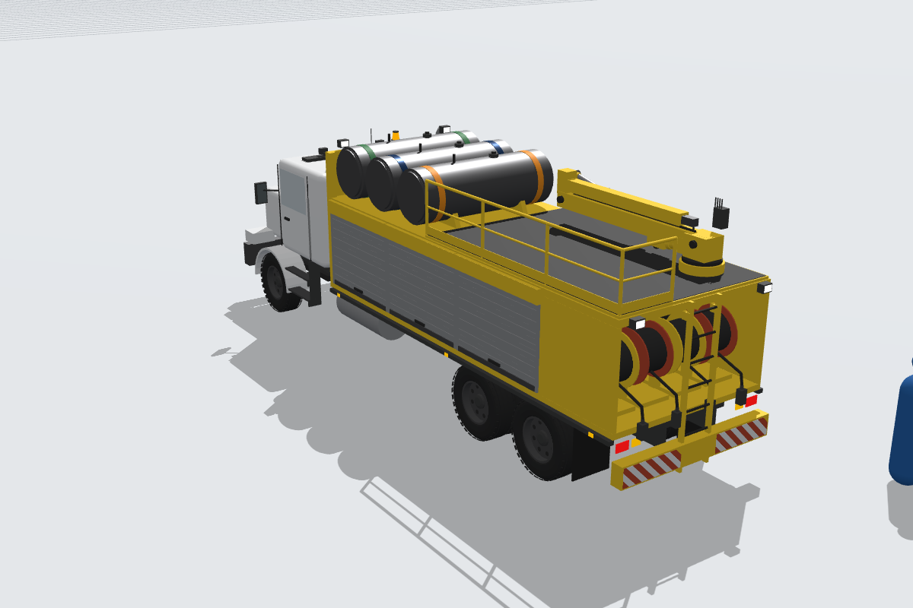
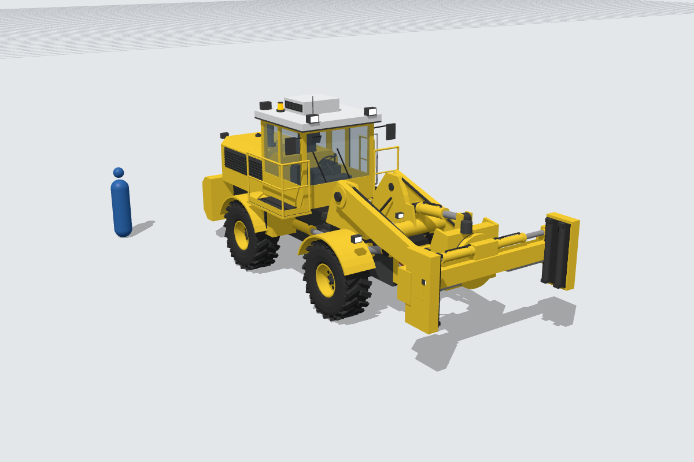
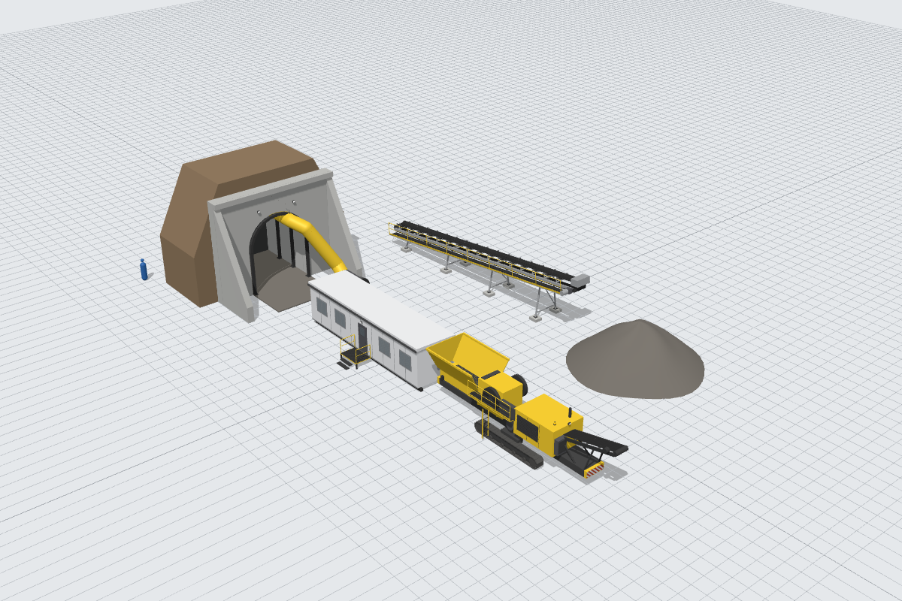

## Materials

Colour scheme: `paint_yellow` bodies on `chassis_black` frames, `paint_white` cab roofs,
`lamp_beacon` beacons, `lamp_amber` indicators and reflective `paint_red` / `paint_white`
hazard stripes on bumpers, counterweights and skid ends. The light vehicle body is
`paint_white`.

Materials used across the pack: `paint_yellow`, `paint_white`, `paint_red`, `paint_orange`
(buggy-whip pole), `paint_gray_dark`, `chassis_black`, `plastic_black`, `steel`, `steel_dark`,
`track_steel`, `wear_steel`, `chrome`, `aluminum`, `tyre_rubber`, `hose_rubber`, `rubber_trim`,
`seat_fabric`, `glass`, `glass_tinted`, `lamp_lens`, `lamp_amber`, `lamp_red`, `lamp_beacon`,
plus the existing site-prop materials `concrete` (sign footings) and `gravel` (berm rocks).

Expansion 2 uses the same scheme (the service truck cab and the site office are
`paint_white`) and adds no new material names. It also uses `aluminum` (drill feeds, roll-up
doors, window frames), `cable_rubber` (jumbo cable reel), `paint_gray` / `paint_gray_dark`
(conveyor steelwork, cabinets, fan), `paint_red` (rock drills, fire bottle),
`paint_orange` / `paint_blue` / `paint_green` (identification bands on the lube-truck
tanks), `paint_yellow` for the ventilation duct, and the existing Mining addition `dirt` for
the portal backfill. `concrete` and `gravel` are used for the portal, trestle pads and
stockpile.

**One new material:** `dirt` (the safety berm), because nothing on the list fits a dirt
windrow. `validate_glb.py` flags it (`material "dirt" not in the allowed list`). That and
the dozer's track-shoe rotations (see above) are the only findings in the pack, and both
are expected. The processing props report the same `dirt` finding.

## Files in this folder

* `build_*.py`: one script per model, each writes `<slug>/<slug>.glb`.
* `build_all.py`: regenerates all twelve models.
* `mining_parts.py`: Mining-specific helpers. It imports the shared modules from
  `3d-models/` through `sys.path` and does not change them. It contains:
  * `hydraulic_parts_with_hoses`: wraps the shared `meshkit.hydraulic_parts` to add a hose run
    (two fittings and a hose line) on top of every cylinder barrel. Importing `mining_parts`
    installs it as the builder that `meshkit.Model.finalize` uses, **only in that Python
    process**, so the Construction models are unaffected.
  * `blade`: a copy of `dozer_parts.blade` with a scale factor `k` for the fixed-size details
    (bolts, end plates, ribs, edge lips), which are too small at 6 m blade scale. It is used
    for the U-blade and the grader moldboard.
  * `cab`: adapted from `dozer_parts.cab`, with heavier ROPS posts, a separate roof material
    (white), a roof pressuriser/A-C unit, LED lamps, two beacons, an aerial and an optional
    steering wheel.
  * `stairs`, `guardrail` (top rail, mid rail, posts, kickplate), `ladder`, `deck`
    (plate with grating), `hazard_stripes` (diagonal red/white bands on any rectangle).
  * Scaled-up `lamp`, `beacon`, `louvres`, `exhaust`, `precleaner`, `tank_cap`,
    `sight_gauge`.
  * `underground_cab`: low side-mounted operator compartment for underground machines (ROPS
    posts, FOPS roof bars, transverse seat, joystick consoles, glazing, glazed door or open
    entry with mesh guard, lamps, beacon), used by the haul truck and the jumbo.
  * `MINING_MATERIALS`: the shared library plus `dirt`.
* `check_zfighting_mining.py`: runs the shared z-fighting checker (`../check_zfighting.py`)
  over the Mining builders. All twelve report 0 z-fighting pairs.
* `preview/`: `render_previews.js` and `preview.html` regenerate the `preview.png` files
  with three.js in headless Chromium, in the same style as the Construction previews.

## Regenerating and checking

```bash
python3 3d-models/Mining/build_all.py
```

```bash
python3 3d-models/validate_glb.py Mining/
```

```bash
python3 3d-models/Mining/check_zfighting_mining.py
```

To re-render the previews, which needs Node, `three@0.160.0` and Playwright:

```bash
cd 3d-models/Mining/preview && npm install three@0.160.0 playwright && node render_previews.js
```
