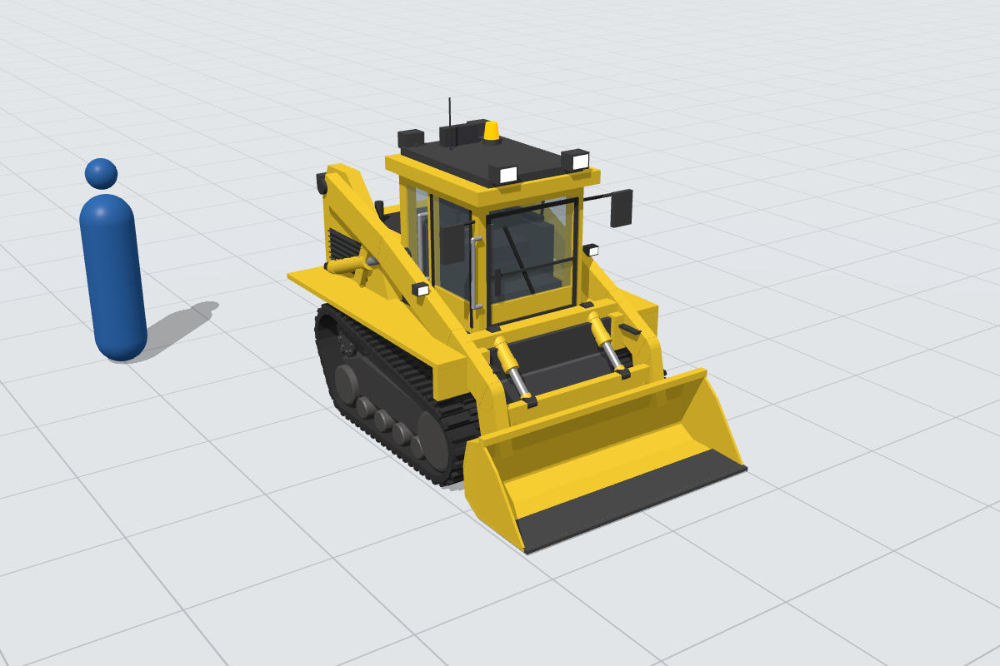
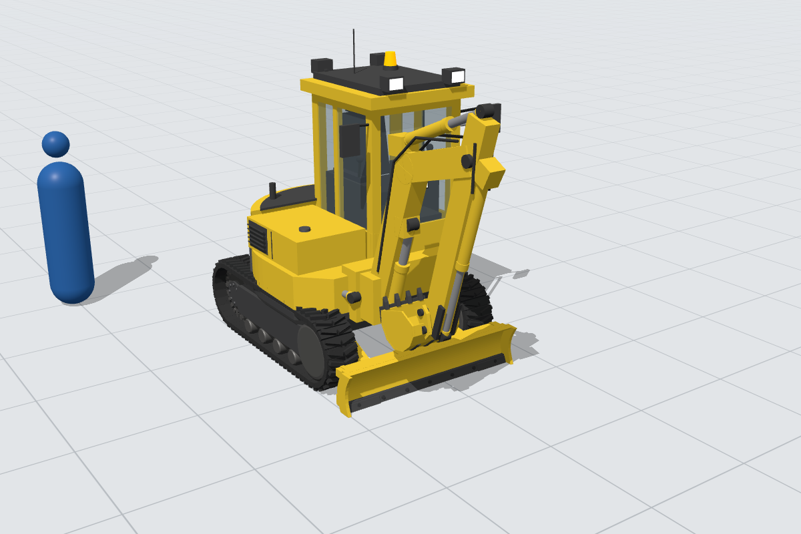
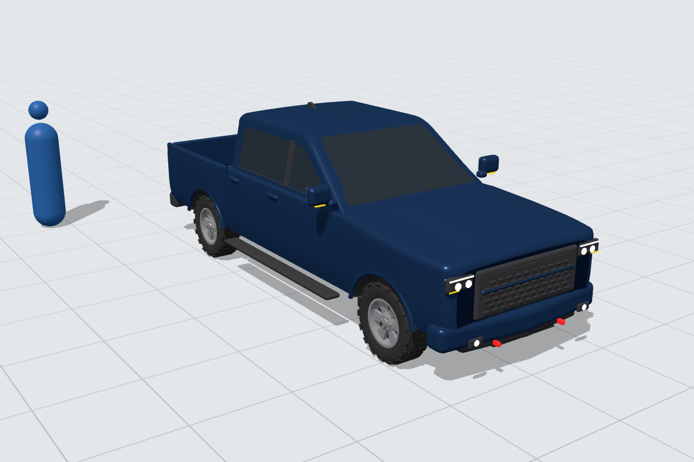
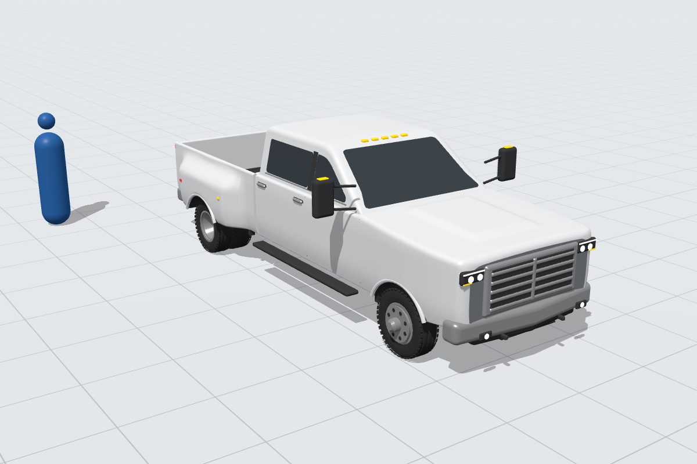

# 3D models

A pack of detailed, true-scale (1:1, metres) construction models, each a single self-contained
`.glb`, generated from plain Python (no Blender or other 3D software needed). All models live in
the `Construction/` folder, one subfolder per model.

### Machines and vehicles

| Model | File | Size (L × W × H) | Notes |
|---|---|---|---|
| **Crawler dozer** (tracked bulldozer, ~20 t class) | `Construction/crawler-dozer/crawler_dozer.glb` | ≈ 6.1 × 3.5 × 3.6 m | Semi-U blade 3.40 × 1.30 m, 1.98 m track gauge, 560 mm shoes, 203 mm chain pitch, 3-shank ripper |
| **Wheel dozer** (rubber-tyred articulated bulldozer, ~30 t class) | `Construction/wheel-dozer/wheel_dozer.glb` | ≈ 8.0 × 4.1 × 4.3 m | Straight blade 4.00 × 1.55 m, 3.70 m wheelbase, 2.40 m tread, 29.5R25 tyres |
| **Backhoe loader** (4WD, ~8 t) | `Construction/backhoe-loader/backhoe_loader.glb` | ≈ 6.6 × 2.4 × 3.8 m | 2.30 m loader bucket, 610 mm backhoe bucket with teeth, boom stowed and stabilisers folded for travel; 12.5/80-18 front and 16.9-28 rear tyres |
| **Compact (mini) excavator** (zero tail swing, ~3.5 t) | `Construction/mini-excavator/mini_excavator.glb` | ≈ 3.6 × 1.75 × 2.5 m | 300 mm rubber tracks, 0.87 m tail swing radius, offset boom on swing post, 450 mm bucket, dozer blade, cab; arm and bucket curled for travel |
| **Compact track loader** (vertical lift, ~4.5 t) | `Construction/compact-track-loader/compact_track_loader.glb` | ≈ 3.4 × 1.98 × 2.1 m | 400 mm rubber tracks on raised-sprocket undercarriage, vertical-lift arms, quick-attach plate, 1.98 m bucket |
| **Wheel tractor scraper** (single engine, ~16 m³ bowl) | `Construction/wheel-tractor-scraper/wheel_tractor_scraper.glb` | ≈ 13.2 × 3.6 × 3.9 m | Gooseneck and draft arms, bowl with apron, ejector, cutting edge and stinger, rear push block; 33.25-29 tyres |
| **Articulated dump truck** (6x6 off-road, ~40 t class) | `Construction/articulated-dump-truck/articulated_dump_truck.glb` | ≈ 10.9 × 3.6 × 3.7 m | Articulation hitch, tandem bogie with walking beams, tipping body with tail chute and hoist cylinders; 875/65R29 tyres |
| **Pickup truck** (half-ton crew cab, 5.5 ft bed, 4x4) | `Construction/pickup-truck/pickup_truck.glb` | ≈ 6.0 × 2.03 (2.5 with mirrors) × 1.96 m | 3.68 m wheelbase, 275/65R18 all-terrain tyres on 6-spoke alloys, LED lighting, bed with wheelhouses, under-bed spare |
| **Dually pickup truck** (one-ton heavy duty crew cab, 8 ft bed) | `Construction/dually-pickup-truck/dually_pickup_truck.glb` | ≈ 6.8 × 2.44 (3.0 with tow mirrors) × 2.03 m | 4.29 m wheelbase, dual rear wheels with flared fenders, LT235/80R17 tyres, chrome bumpers, roof clearance lights, tow mirrors |

### Site equipment, cabins, structures and materials

| Model | File | Size (L × W × H) | Moving parts / notes |
|---|---|---|---|
| **Site office trailer** | `Construction/site-office-trailer/site_office_trailer.glb` | 6.0 × 2.4 cabin, 2.6 m to the roof (steps and AC unit stick out) | Corrugated steel cladding, 2 barred windows, door `door_rotate` hinged on its left edge, steel steps with handrails, wall AC unit, base frame with fork pockets on 6 screw jacks with timber pads |
| **20 ft shipping container** | `Construction/shipping-container-20ft/shipping_container_20ft.glb` | 6.06 × 2.44 × 2.59 m | Corrugated walls and roof, 8 corner castings, fork pockets; rear doors `door_L_rotate` / `door_R_rotate` hinged at the outer edges, with locking bars and handles |
| **Towable light tower** | `Construction/light-tower/light_tower.glb` | 3.1 × 1.5 × 2.7 m (stowed) | 4 LED heads on `lamp_head_rotate` (turns on Y); mast telescopes 2.5 → 8 m through `mast_lift` → `mast_stage_2_lift` → `mast_stage_3_lift` → `mast_stage_4_lift` (1.375 m each); 4 legs `outrigger_{front,rear}_{left,right}_slide`; wheels and jockey wheel `_spin` |
| **Towable diesel generator** | `Construction/diesel-generator/diesel_generator.glb` | 3.2 × 1.5 × 1.8 m | Enclosed canopy on a single-axle trailer, side access door `panel_rotate`, control panel, sockets, exhaust, louvres; wheels `_spin` |
| **Bunded fuel tank, 1000 L** | `Construction/fuel-tank-1000l/fuel_tank_1000l.glb` | 2.5 × 1.1 × 1.5 m | Double-walled tank on skids with fork pockets, fill cap, vent, gauge, leak indicator, pump cabinet with meter, `hose_reel_spin`, hose and nozzle in holster |
| **Rebar bundle** | `Construction/rebar-bundle/rebar_bundle.glb` | 12.1 × 1.0 × 0.25 m | 30 × 25 mm bars, 12 m, 3 steel strap ties, timber dunnage |
| **Lumber stack** | `Construction/lumber-stack/lumber_stack.glb` | 6.0 × 4.3 × 0.65 m | Three nodes: `lumber_2x4_bundle` (80 boards, banded), `plywood_stack` (30 sheets 2.44 × 1.22), `timber_beams` (150 × 300 mm, 6 m, two layers with stickers), each on bearers |
| **Concrete pipes** | `Construction/concrete-pipes/concrete_pipes.glb` | 5.3 × 2.4 × 1.6 m | Three 1.2 m internal-diameter socketed pipes on bearers, chocked with timber wedges |
| **Sandbag stack** | `Construction/sandbag-stack/sandbag_stack.glb` | 4.6 × 1.4 × 0.34 m | Three courses (two rows deep) plus 2 loose bags |
| **Rubble and gravel piles** | `Construction/rubble-and-gravel-piles/rubble_and_gravel_piles.glb` | 7.1 × 3.0 × 1.1 m | Two nodes: `rubble_heap` (broken concrete chunks and bent rebar ends) and `gravel_pile` (smooth cone) |
| **Site hoarding** | `Construction/site-hoarding/site_hoarding.glb` | 4.9 × 1.35 × 2.45 m | Modular 2.4 m plywood section on timber posts with rails and kicker braces, plus gate section with `gate_rotate` (strap hinges, hasp, padlock, drop bolt) |
| **Survey tripod and stake** | `Construction/survey-tripod-and-stake/survey_tripod_and_stake.glb` | 1.9 × 0.8 × 1.6 m | Tripod with total station (`total_station_rotate`, `telescope_tilt`), timber survey stake with pink flagging tape |
| **Stair tower** | `Construction/stair-tower/stair_tower.glb` | 2.8 × 1.5 × 4.1 m | Modular 2.6 × 1.3 m scaffold-tube frame on screw jacks, 2 flights of 1.5 m with landings, handrails, toe boards |
| **Skip bin and bulk bag** | `Construction/skip-bin-and-bulk-bag/skip_bin_and_bulk_bag.glb` | 5.1 × 1.9 × 1.3 m | Two nodes: 6 cu yd `skip_bin` with lifting trunnions, and `bulk_bag` of sand on a pallet |
| **Material hoist** | `Construction/material-hoist/material_hoist.glb` | 4.0 × 2.1 × 9.3 m | Six 1.508 m lattice mast sections with rack, base frame and enclosure; cage with drive unit on `cage_lift` (rests on the buffers in the rest pose) |

Heights are to the top of the cab or roof (or the stowed boom); antennas and exhausts can add a
little. All of these are generic designs based on typical dimensions for their class — no real
manufacturer names, model numbers or logos.







### Triangle counts

"Drawn" is what a viewer renders; "unique" is what the file stores. They differ only for the
three tracked machines, whose track shoes reuse one mesh per side (see
[Track structure](#track-structure)).

| Model | Drawn | Unique |
|---|---:|---:|
| Crawler dozer | 71.6k | 38.2k |
| Dually pickup truck | 58.7k (was 123.8k) | 58.7k |
| Pickup truck | 55.0k (was 120.9k) | 55.0k |
| Articulated dump truck | 43.8k | 43.8k |
| Backhoe loader | 39.3k | 39.3k |
| Wheel dozer | 38.1k | 38.1k |
| Wheel tractor scraper | 37.6k | 37.6k |
| Mini excavator | 26.1k | 20.0k |
| Sandbag stack | 24.6k | 24.6k |
| Light tower | 24.3k | 24.3k |
| Compact track loader | 23.2k | 17.8k |
| Diesel generator | 22.1k | 22.1k |
| Material hoist | 13.6k | 13.6k |
| Shipping container 20 ft | 13.5k | 13.5k |
| Site office trailer | 12.7k | 12.7k |
| Fuel tank 1000 L | 9.3k | 9.3k |
| Rubble and gravel piles | 5.7k | 5.7k |
| Stair tower | 5.4k | 5.4k |
| Survey tripod and stake | 3.2k | 3.2k |
| Skip bin and bulk bag | 2.8k | 2.8k |
| Concrete pipes | 2.4k | 2.4k |
| Rebar bundle | 1.7k | 1.7k |
| Lumber stack | 1.6k | 1.6k |
| Site hoarding | 0.9k | 0.9k |

The pickups were slimmed without changing their shape, rig, materials or UV rules.
Rounded trim boxes now use 1–4 corner segments depending on their radius (1 mm chord
error) instead of always 4. Loft rings sit 10–12 cm apart only where the body section changes
(fender flares, wheel arches, hood, windshield, dually pods) and are sparse along the
constant cab and bed sections. Tyres have 36 segments and rims 32 (about 1.5 mm chord error).
Faces that can't be seen were dropped: the buried backs of the grille blocks and the hub
face of the inner rear duals.

## What's modelled

**Crawler dozer:** individual track shoes (42 per side, separate nodes) with grousers, chain
links, bushings and shoe bolts running a correct belt path round the idler and sprocket; 7 double-flange bottom rollers and
2 carrier rollers per side; toothed drive sprockets and final drives; track frames, roller
guards, recoil housings, equaliser bar and pivot shaft; engine hood with side louvres, front
radiator guard, exhaust and air pre-cleaner; semi-U blade with curved moldboard, cutting edge,
bolts, end bits, ribs and box beams; C-frame push arms on trunnions, tilt cylinder and brace,
twin lift cylinders with chrome rods and hoses; ROPS cab with glazing, seat, consoles,
joysticks, pedals, wipers, mirrors, work lights and beacon; fenders, fuel tank, handrails,
tail lights; parallelogram multi-shank ripper with tips and cylinders.

**Wheel dozer:** four tyres with L-3 style chevron lugs, rims, hubs and wheel nuts; axles with
differentials and planetary final drives; articulated front/rear frames with hitch pins and
steering cylinders; arched front fenders, rear walkway decks with tread plate, handrails and
access ladder; rear engine enclosure with louvres, rear radiator grille and counterweight;
exhaust and pre-cleaner; straight blade, push arms, lift and tilt cylinders; ROPS cab.

## File conventions (model pack)

* **One `.glb` per model**, glTF 2.0, textures embedded, no Draco or other compression.
* **Units:** metres at real-world scale. **+Y is up, every vehicle faces +X.** The origin is on
  the ground, centred under the vehicle.
* **Rest pose:** wheels straight, dump body down, tailgate closed, booms stowed (the backhoe
  and mini excavator are in travel position, stabilisers folded up).

### Rigging

Every node and mesh has a descriptive name (`cab`, `frame`, `boom_tilt`, …). Moving parts
carry a suffix and their node origin sits on the real pivot. Node rotations are identity in
the rest pose; the only exception is track shoes (see below).

| Suffix | Motion | Used for |
|---|---|---|
| `_steer` | rotate about Y at the kingpin | front wheels of the backhoe and pickups |
| `_spin` | rotate about Z at the wheel centre | every wheel, track idler, sprocket and roller, fuel-tank hose reel |
| `_tilt` / `_rotate` | hinge rotation about the pivot | blades, push frames, booms, dippers/arms, buckets, loader arms, ripper, dump body, scraper bowl and apron, tailgate, stabilisers; articulation hitches, excavator slew ring and swing post, linkages; cabin, container and generator doors, hoarding gate, light-tower lamp head, total station and telescope |
| `_slide` | translation | scraper ejector, light-tower outriggers, every hydraulic cylinder rod |
| `_lift` | vertical translation | light-tower mast stages, hoist cage |

Each hydraulic cylinder is `<name>_rotate` (barrel, origin at its base pin, child of the part
it is mounted on) with a child `<name>_rod_slide` (origin at the rod-eye pin). Parts that don't
move have no suffix.

### Track structure

The crawler dozer, compact track loader and mini excavator have tracks made of separate shoe
nodes, so a viewer can run them:

* `track_left` and `track_right` are group nodes with no mesh. Their origin lies in the
  track's centre plane (z = ±the track's half gauge). Their children are the shoes, in order
  round the loop: `track_right_shoe_00`, `track_right_shoe_01`, … (same for the left).
* Both sides are numbered in the same travel direction: counter-clockwise seen from +Z. Shoe
  00 is at the rearmost point of the loop (the back of the sprocket, level with its centre).
  The sequence runs down round the sprocket, forward along the ground run, up round the front
  idler and back along the top.
* Each shoe node's origin sits on the chain pitch line, which is the belt path round the
  idler and sprocket pitch circles (plus the rear idler on the compact track loader). Its rotation follows the loop: local +X along the
  tangent (the travel direction), local +Y inward toward the rollers, local +Z = world +Z.
  Shoes on the bottom run have identity rotation.
* Shoes are evenly spaced: the loop length divided by the shoe count, which is the pitch
  rounded to a whole number of shoes (distances measured along the loop). Moving shoe N to
  shoe N+1's rest transform (translation and rotation) runs the track forward by one shoe,
  and looping that runs it continuously.
* Every shoe on a side reuses one glTF mesh, `track_<side>_shoe`. The shoes have no rig suffix.
  Rollers, carrier rollers, idlers and sprockets are still `_spin` nodes with their origins on
  their centres.

| Model | Shoes per side | Spacing | Shoe |
|---|---:|---:|---|
| Crawler dozer | 42 | 0.2019 m (203 mm chain pitch) | steel shoe: plate, main and half grousers, links, pin, bushing and bolts (`track_steel`) |
| Compact track loader | 57 | 0.0796 m | rubber belt segment with steel guide lug and two staggered tread blocks |
| Mini excavator | 64 | 0.0748 m | rubber belt segment with steel guide lug and a chevron of two angled lugs |

On the rubber tracks each belt segment carries its own lugs, so the tread repeats every
segment. The compact track loader's blocks alternated sides every two segments before;
now each segment has a staggered pair. The mini excavator's alternating zigzag lug is now a
chevron.

The shoes are written by `track_kit.py` (`track_loop_nodes`, `rubber_track_nodes`,
`mirror_track_shoes`, `save_with_instanced_tracks`), generalised from the Mining dozer.
The model is finalised with every shoe in place, so centring and bounds include all of them.
Only the first shoe of each side is written with geometry. The `.glb` is then rewritten so
that shoe's mesh is moved into its local frame and every shoe node on that side points to it
with its rotation.

### Materials, textures and UVs

* Materials use only these names: `paint_yellow`, `paint_blue`, `paint_white`,
  `paint_gray_dark`, `chassis_black`, `plastic_black`, `steel`, `steel_dark`, `track_steel`,
  `wear_steel`, `chrome`, `aluminum`, `tyre_rubber`, `hose_rubber`, `rubber_trim`,
  `seat_fabric`, `glass`, `glass_tinted`, `lamp_lens`, `lamp_amber`, `lamp_red`, `lamp_beacon`,
  `paint_red`, `paint_orange`, `paint_green`, `paint_gray` (each model uses the subset it needs,
  one material per surface type).
* Added only for site props, where nothing on the list fits: `timber`, `plywood`, `concrete`,
  `gravel`, `sand`, `woven_polypropylene` (sandbags, bulk bag) and `fabric_pink` (flagging tape).
* Each material has a 1024² PNG `baseColorTexture` named after the material, holding its
  colour; `baseColorFactor` is white (only the glass materials keep an alpha value).
  Metal-roughness PBR only, no vertex colours, no extensions.
* Every primitive has `TEXCOORD_0`. UVs are unwrapped automatically: inside 0–1, no overlaps
  within each material's texture, one texel density for the whole model, and at least 4 px
  between islands (and from the texture edge) at 1024².

## Viewing

Open `viewer.html` through a local web server (browsers block loading `.glb` files from
`file://`):

```bash
cd 3d-models
```

```bash
python3 -m http.server 8000
```

Then browse to http://localhost:8000/viewer.html (it shows the two dozers). It has a 1 m grid, a 1.8 m reference
figure, a wireframe toggle and shows the model's overall dimensions.

## Regenerating

The models are built by code, so dimensions can be tweaked in the constants at the top of each
build script:

```bash
python3 3d-models/build_all.py
```

* `meshkit.py` — mesh library (boxes, cylinders, lathe, extrusions, belt paths), the rigged
  `Model` (nodes, pivots, rest pose, hydraulic cylinders, centring), materials and the `.glb` writer
* `uvkit.py` — automatic UV unwrapping and packing
* `dozer_parts.py` — shared assemblies (blade, cab, lamps, louvres, rails, exhaust)
* `bodykit.py` — smooth bodywork: lofted cross-sections, rounded boxes, flush glass/trim panels
* `vehicle_parts.py` — tyres (earthmover, industrial, all-terrain, highway), rims, rubber
  track belt segments, excavator and loader buckets, steering wheel
* `site_parts.py` — corrugated sheet, rubble chunks, mounds, screw jacks, mesh panels for site props
* `track_kit.py` — tracks as groups of evenly spaced shoe nodes that share one mesh per side
  (see [Track structure](#track-structure))
* `build_*.py` — one script per machine (`build_pickup_trucks.py` writes both pickups;
  `build_site_cabins.py`, `build_site_equipment.py`, `build_site_materials.py` and
  `build_site_structures.py` each write several site models)
* `check_zfighting.py` — scans every model for z-fighting (coplanar, overlapping faces of
  different materials) and exits non-zero if it finds any: `python3 3d-models/check_zfighting.py`
* `validate_glb.py` — reads the generated `.glb` files and checks them against the model-pack
  rules above (format, orientation and origin, UVs, materials and textures, node naming and
  rig suffixes), exiting non-zero on any failure: `python3 3d-models/validate_glb.py`. It
  allows a unit-quaternion rotation only on `track_<side>_shoe_NN` nodes, computes bounds
  through node rotations, and reports triangles drawn and unique.
* `preview/render_previews.js` — renders `Construction/<slug>/preview.png` with three.js in
  headless Chromium (grey ground with a 1 m grid and a 1.8 m reference figure):
  `cd 3d-models/preview && npm install three@0.160.0 && node render_previews.js [filter]`
