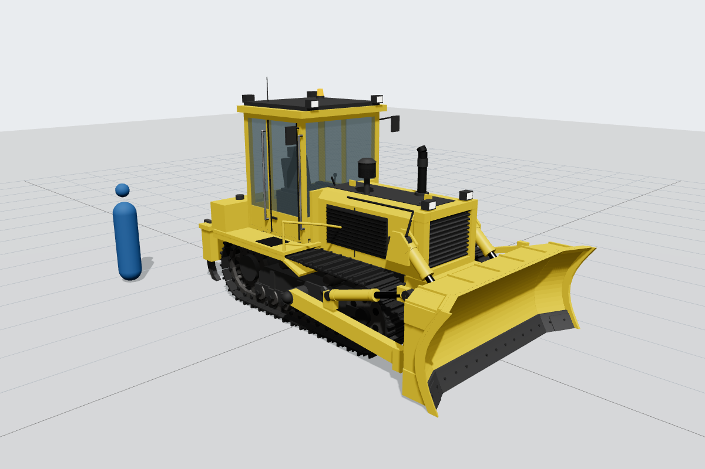
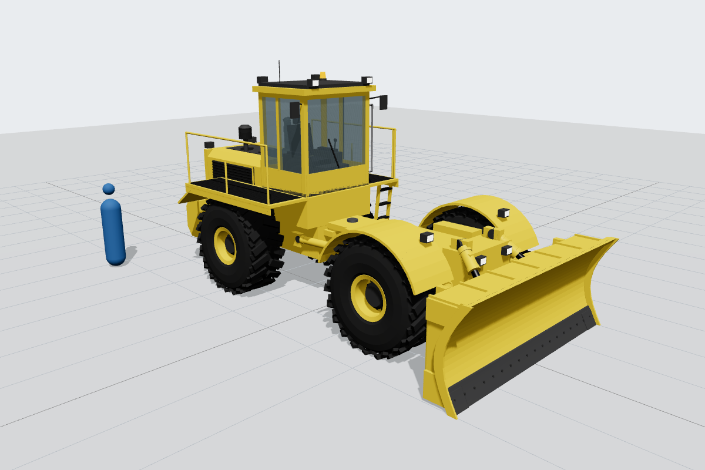

# 3D models

Detailed, true-scale (1:1, metres) 3D models of earthmoving equipment, generated from
plain Python (standard library only — no Blender or other dependencies).

| Model | Files | Size (L × W × H) | Notes |
|---|---|---|---|
| **Crawler dozer** (tracked bulldozer, ~20 t class) | `crawler-dozer/crawler_dozer.glb`, `.obj` + `.mtl` | ≈ 6.1 × 3.5 × 3.3 m (3.6 m to antenna tip) | Semi-U blade 3.40 × 1.30 m, 1.98 m track gauge, 560 mm shoes, 203 mm chain pitch, 3-shank ripper |
| **Wheel dozer** (rubber-tyred articulated bulldozer, ~30 t class) | `wheel-dozer/wheel_dozer.glb`, `.obj` + `.mtl` | ≈ 8.0 × 4.1 × 3.9 m (4.3 m to antenna tip) | Straight blade 4.00 × 1.55 m, 3.70 m wheelbase, 2.40 m tread, 29.5R25 tyres |

### More models (GLB only)

| Model | File | Size (L × W × H) | Notes |
|---|---|---|---|
| **Backhoe loader** (4WD, ~8 t) | `backhoe-loader/backhoe_loader.glb` | ≈ 7.8 × 2.7 × 3.5 m | 2.30 m loader bucket, 610 mm backhoe bucket with teeth, stabilisers down, boom raised ready to dig; 12.5/80-18 front and 16.9-28 rear tyres |
| **Compact (mini) excavator** (zero tail swing, ~3.5 t) | `mini-excavator/mini_excavator.glb` | ≈ 3.9 × 1.75 × 2.5 m | 300 mm rubber tracks, 0.87 m tail swing radius, offset boom on swing post, 450 mm bucket, dozer blade, cab |
| **Compact track loader** (vertical lift, ~4.5 t) | `compact-track-loader/compact_track_loader.glb` | ≈ 3.4 × 1.98 × 2.1 m | 400 mm rubber tracks on raised-sprocket undercarriage, vertical-lift arms, quick-attach plate, 1.98 m bucket |
| **Wheel tractor scraper** (single engine, ~16 m³ bowl) | `wheel-tractor-scraper/wheel_tractor_scraper.glb` | ≈ 13.2 × 3.6 × 3.9 m | Gooseneck and draft arms, bowl with apron, ejector, cutting edge and stinger, rear push block; 33.25-29 tyres |
| **Articulated dump truck** (6x6 off-road, ~40 t class) | `articulated-dump-truck/articulated_dump_truck.glb` | ≈ 10.9 × 3.6 × 3.7 m | Oscillating articulation hitch, tandem bogie with walking beams, tipping body with tail chute and hoist cylinders; 875/65R29 tyres |
| **Pickup truck** (half-ton crew cab, 5.5 ft bed, 4x4) | `pickup-truck/pickup_truck.glb` | ≈ 5.9 × 2.03 (2.5 with mirrors) × 1.96 m | 3.68 m wheelbase, 275/65R18 all-terrain tyres on 6-spoke alloys, LED lighting, bed with wheelhouses, under-bed spare |
| **Dually pickup truck** (one-ton heavy duty crew cab, 8 ft bed) | `dually-pickup-truck/dually_pickup_truck.glb` | ≈ 6.7 × 2.44 (3.0 with tow mirrors) × 2.03 m | 4.29 m wheelbase, dual rear wheels with flared fenders, LT235/80R17 tyres, chrome bumpers, roof clearance lights, tow mirrors |

Heights in the table are to the top of the cab or roof; antennas and exhausts can add a little.
The construction machines are in yellow and black; the pickups are dark blue (half-ton) and
white (dually).

All of these are generic designs based on typical dimensions for their class, not copies of
any manufacturer's machine.




## What's modelled

**Crawler dozer:** individual track shoes with grousers, chain links, bushings and shoe bolts
running a correct belt path round the idler and sprocket; 7 double-flange bottom rollers and
2 carrier rollers per side; toothed drive sprockets and final drives; track frames, roller
guards, recoil housings, equaliser bar and pivot shaft; engine hood with side louvres, front
radiator guard, exhaust and air pre-cleaner; semi-U blade with curved moldboard, cutting edge,
bolts, end bits, ribs and box beams; C-frame push arms on trunnions, tilt cylinder and brace,
twin lift cylinders with chrome rods and hoses; ROPS cab with glazing, seat, consoles,
joysticks, pedals, wipers, mirrors, work lights and beacon; fenders, fuel tank, handrails,
tail lights; parallelogram multi-shank ripper with tips and cylinders.

**Wheel dozer:** four tyres with L-3 style chevron lugs, rims, hubs and wheel nuts; axles with
differentials and planetary final drives; articulated front/rear frames with hitch pins and
steering cylinders; arched front fenders, rear walkway decks with tread plate, handrails and
access ladder; rear engine enclosure with louvres, rear radiator grille and counterweight;
exhaust and pre-cleaner; straight blade, push arms, lift and tilt cylinders; ROPS cab.

## File formats

* **`.glb`** (glTF 2.0 binary) — recommended. Opens in Blender, Windows 3D Viewer, three.js,
  Unity/Unreal importers, and online viewers such as gltf-viewer.donmccurdy.com. Each
  sub-assembly (blade, cab, tracks, wheels, …) is a separate named node.
* **`.obj` + `.mtl`** — for tools without glTF support. Keep the two files together.

Coordinates: **+Y up, +X forward**, origin on the ground under the machine's centre, 1 unit = 1 m.

## Viewing

Open `viewer.html` through a local web server (browsers block loading `.glb` files from
`file://`):

```bash
cd 3d-models
```

```bash
python3 -m http.server 8000
```

Then browse to http://localhost:8000/viewer.html. It has a 1 m grid, a 1.8 m reference
figure, a wireframe toggle and shows the model's overall dimensions.

## Regenerating

The models are built by code, so dimensions can be tweaked in the constants at the top of each
build script:

```bash
python3 3d-models/build_all.py
```

* `meshkit.py` — tiny mesh library (boxes, cylinders, lathe, extrusions, belt paths) with
  `.glb` and `.obj` writers
* `dozer_parts.py` — shared assemblies (blade, cab, lamps, louvres, rails, exhaust)
* `bodykit.py` — smooth bodywork: lofted cross-sections, rounded boxes, flush glass/trim panels
* `vehicle_parts.py` — tyres (earthmover, industrial, all-terrain, highway), rims, rubber
  tracks, excavator and loader buckets, steering wheel
* `build_*.py` — one script per machine (`build_pickup_trucks.py` writes both pickups)
